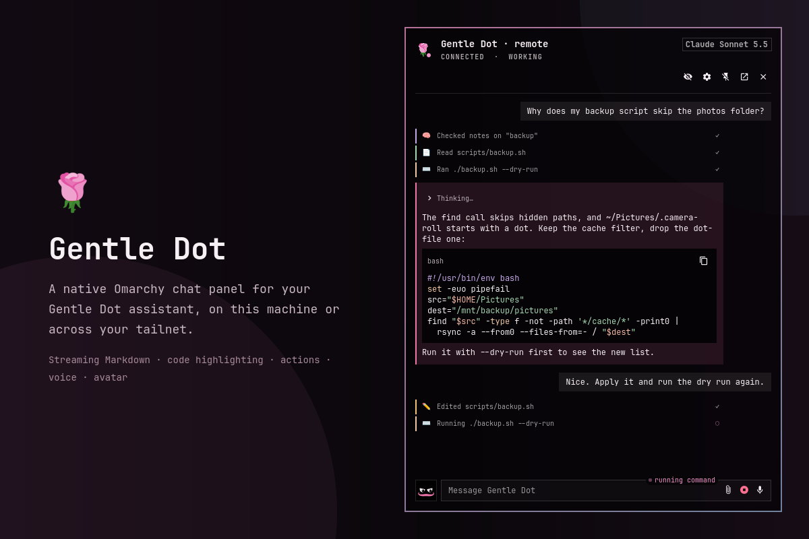
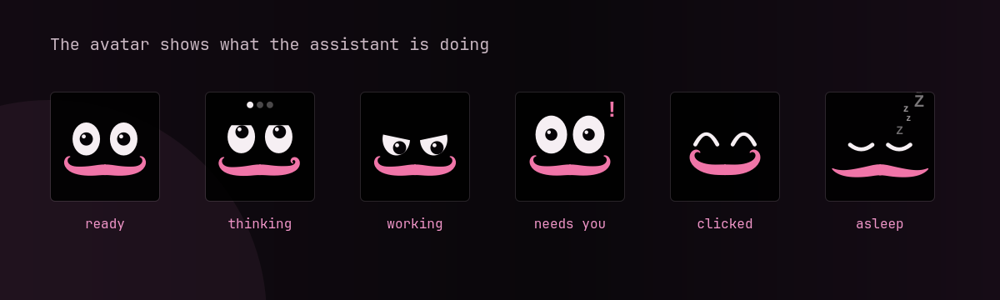

<a id="top"></a>

# Gentle Dot for Omarchy

**A native Omarchy bar panel for [Gentle Dot](https://github.com/Gentleman-Programming/gentle-dot): chat with your assistant, on this machine or across your tailnet, without leaving the desktop.**

<p>

<a href="LICENSE"></a>
</p>

A bar icon and a chat panel drawn by the Omarchy shell itself (Quickshell/QML), with your theme's colors and fonts. No WebKitGTK window, so none of its flicker on NVIDIA + Hyprland.



## Requires Gentle Dot

This plugin is only a client. It needs a running **Gentle Dot daemon**, on this machine or on
another one you can reach (for example a Mac in your tailnet). Without one the panel stays
"offline".

1. **Install Gentle Dot** from [github.com/Gentleman-Programming/gentle-dot](https://github.com/Gentleman-Programming/gentle-dot):
   follow its *Get started* section and `docs/install.md` (desktop app, Linux packages, or
   `pnpm dev` from a checkout).
2. **Run it.** The Gentle Dot app, or its daemon alone, listens on `127.0.0.1:4317`. The plugin
   connects to `ws://127.0.0.1:4317/ws` by default.
3. **The token.** The daemon keeps its access key in `~/.gentle-dot/token` on its own machine.
   The plugin reads it from that file on every connect and never stores it in `shell.json`.
4. **Another machine?** Publish the daemon inside your tailnet with `tailscale serve --bg 4317`
   on that machine, then pick it in the panel's **Settings → Remote** and paste its token once.
   See [Remote daemon](#remote-daemon).

### Stock daemon or newer daemon

Everything works with the Gentle Dot daemon as published today (protocol v1). A few extras need
optional protocol v1 fields that are **proposed upstream** but not in a Gentle Dot release yet.
They are optional on both sides: an older daemon simply does not send them, and the plugin falls
back as described.

| Feature | Stock Gentle Dot | Needs a Gentle Dot version with the proposed fields |
|---|---|---|
| Chat, streaming replies, history, Markdown, code highlighting | Yes | |
| The assistant's questions, attachments you send, notifications, voice, avatar | Yes | |
| Action lines with a generic icon per kind (memory, files, shell, web…) | Yes | |
| Rich activity: per-integration icons (Slack, Linear, Gmail, Notion, Atlassian, Discord, RDD review, MCP) and expandable arguments/output, formatted per tool | | `source`, `tool`, `detail`, `output` on activities |
| Model reasoning in a **Thinking…** section | | `reasoning_delta`, `reasoning` on replies and history |
| Code whitespace kept in replies loaded from history | Kept for replies streamed during the current connection | The daemon stops collapsing whitespace inside code |
| Message times | Remembered locally for messages this client saw live | `at` on messages and history |
| Images and files from history or other clients | Shown as a chip ("preview unavailable") | `uploadId` and authenticated `GET /upload/<uploadId>/<name>` |
| Status label for connectors, RDD review and the agent's phase | Falls back to "working" | `tool` and `source` on activities |

## What you get

- **Bar icon**: dim when disconnected, accent while the assistant is thinking or working, urgent when it needs you.
- **Chat panel**: your conversation history, streaming replies with Markdown, tool activity, message times and a copy icon per reply (both shown on hover), file attachments with image previews, a multi-line composer, and Stop. **Enter** sends; **Shift+Enter** inserts a newline. The field wraps and grows to about eight lines, then scrolls internally. Popup, pinned panel, detached window and dictation share one draft; dictation appends without replacing it. Escape cancels active dictation, otherwise closes an unpinned popup.
- **Dialogs**: the assistant's questions (choose, confirm, type a value) answered right in the panel. Questions that only the Gentle Dot app can answer (`app`, `pin`) say so.
- **Settings** (gear button): this computer or a remote daemon, with a tailnet device picker, a connection test, and Save & connect.
- **Header icons**: settings (󰒓), pin (󰐃), detach/dock (󰏌/󰖲) and close (󰅖), each with a tooltip.
- **Pin**: keeps the panel open while you work in other windows (clicks and typing outside it reach your apps).
- **Avatar**: a small Tamagotchi left of the composer (two eyes and a moustache) that shows what the assistant is doing, watches you type, follows your pointer over the panel, reacts when you click it and falls asleep after a while without activity. See [Avatar](#avatar).
- **Status label**: a small right-aligned caption on the composer's top border that says what the assistant is doing now (ready, thinking, running command, waiting for you…). See [Status label](#status-label).
- **Detach**: turns the panel into a regular window titled `Gentle Dot` that Hyprland tiles, moves, maximizes and fullscreens like any app. **Dock** (or closing the window) puts it back in the bar. Its class is Quickshell's generic `org.quickshell`, so match window rules on the title, for example `hl.window_rule({ match = { title = "^(Gentle Dot)$" }, float = true })`.
- **Voice dictation** (optional): speech transcribed on this machine, only the text is sent. See [Voice dictation](#voice-dictation).

## Requirements

- Omarchy 4 (the Omarchy shell and its plugins).
- Node.js 22 or newer on `PATH`; it runs the plugin's small WebSocket bridge. Without it the panel
  says so and how to install it (`omarchy pkg add nodejs` or mise).
- A running Gentle Dot daemon (see [Requires Gentle Dot](#requires-gentle-dot)).
- For voice: PipeWire's `pw-record` (or `parec`). Settings → Voice installs the rest.

Optional: [Tailscale](https://tailscale.com) on both machines for a remote daemon. Omarchy
already ships what else the panel uses (`wl-clipboard`, a Nerd Font, `pw-play`). No Docker, no
WebKit, no system services, nothing to build.

## Install

```sh
omarchy plugin add https://github.com/kattsushi/omarchy-gentle-dot.git --enable
```

The bar icon appears in the right section; move it with `omarchy bar move`. That is all chat
needs. Two optional steps, both from the panel's Settings (gear button):

- **Voice**: Settings → Voice → **Enable voice**. See [Voice (optional)](#voice-optional).
- **Keyboard shortcut**: Settings → Shortcut → **Copy setup**, then paste it as described in
  [Keyboard shortcut](#keyboard-shortcut).

Omarchy's installer only clones the plugin (it never runs plugin code), so these steps happen on
first use instead. Without `--enable` the plugin lands disabled so you can read the code first;
`omarchy plugin enable omarchy-gentle-dot` enables it later.

From a local checkout instead:

```sh
git clone https://github.com/kattsushi/omarchy-gentle-dot.git
cd omarchy-gentle-dot
ln -s "$PWD" ~/.config/omarchy/plugins/omarchy-gentle-dot
omarchy-shell shell rescanPlugins
omarchy plugin enable omarchy-gentle-dot
```

### Keyboard shortcut

`SUPER + ALT + D` shows or hides the panel. The plugin never edits your Hyprland config, so the
binding is one paste away: Settings → Shortcut shows whether it is set up, and **Copy setup** puts
[`hypr/gentle-dot.lua`](hypr/gentle-dot.lua) on the clipboard. Save it as
`~/.config/hypr/gentle-dot.lua` and add this line to `~/.config/hypr/hyprland.lua`:

```lua
require("hypr.gentle-dot")
```

The snippet unbinds `SUPER + ALT + D` first, so it replaces the binding the Gentle Dot desktop app's own snippet adds. Any other key works too: the command is

```sh
omarchy-shell shell toggle omarchy-gentle-dot '{}'
```

Settings detects the binding with `hyprctl binds -j`: a bind that runs that command, or a Lua bind
described as "Gentle Dot" (as the snippet does).

### Voice (optional)

Settings → Voice → **Enable voice** does it in one step, with progress and a Cancel:

1. installs the speech runtime, `sherpa-onnx-node` 2.0.1 (about 35 MB with its native libraries),
   with the npm that comes with Node.js, into `~/.local/share/omarchy-gentle-dot/runtime/`, and
   checks that it loads. It never writes into the plugin folder, so `omarchy plugin update` and
   `omarchy plugin validate` never see a `node_modules` there;
2. downloads the speech model (487 MB, checksum verified);
3. checks for a recorder and says what to install if `pw-record` and `parec` are both missing.

If a step fails, the error is shown and the button becomes **Retry**. From a terminal:
`node voice/setup.mjs status|enable`. Until it is done, the mic opens Settings → Voice and says
"Voice needs a one-time setup: Settings → Voice → Enable voice."

### Update

```sh
omarchy plugin update omarchy-gentle-dot
```

It fetches, shows the diff and fast-forwards. If the panel still behaves like the old version,
restart the shell (`omarchy-restart-shell`).

### Remove

```sh
omarchy plugin remove omarchy-gentle-dot
```

Then remove what the plugin created outside its folder:

- the shortcut: delete `~/.config/hypr/gentle-dot.lua` and the `require("hypr.gentle-dot")` line
  in `~/.config/hypr/hyprland.lua`;
- its data and caches:

  ```sh
  rm -rf ~/.local/share/omarchy-gentle-dot   # the voice runtime and model
  rm -rf ~/.local/state/omarchy-gentle-dot   # remembered message times
  rm -rf ~/.config/gentle-dot/remotes        # tokens of remote daemons
  rm -rf "$XDG_RUNTIME_DIR/omarchy-gentle-dot"   # pasted/dropped files and downloads (cleared at logout anyway)
  ```

  (or the same folders under `$XDG_DATA_HOME` and `$XDG_STATE_HOME` if you set them).

Gentle Dot itself and its `~/.gentle-dot` folder are not touched.

## Remote daemon

The Gentle Dot daemon only listens on `127.0.0.1:4317`, so another machine cannot reach it until you publish it. `tailscale serve` does that inside your tailnet only, over HTTPS, without exposing the port to your LAN.

On the machine that runs Gentle Dot (for example a Mac):

```sh
tailscale serve --bg 4317      # https://<device>.<tailnet>.ts.net -> 127.0.0.1:4317, persists across restarts
pbcopy < ~/.gentle-dot/token   # the daemon's access token
```

Then, in the panel, open **Settings** → **Remote**:

1. Pick the device from the tailnet list (or type an IP or DNS name).
2. Keep **Transport: Tailscale HTTPS**. Leave the port empty unless you served on another HTTPS port (`tailscale serve --https=8443 4317` → port `8443`).
3. Paste the token. It is saved to `~/.config/gentle-dot/remotes/<host>.token` (mode 0600), never to `shell.json`.
4. **Test connection**, then **Use this connection** (or **Save & connect**). A test alone never switches the live connection.

The test checks `/health` first and names the cause when it fails: nothing listening (Gentle Dot closed or `tailscale serve` missing), a name that does not resolve, an HTTPS problem, a timeout, a token the daemon rejects.

To stop serving on the Mac: `tailscale serve --https=443 off`.

### Without `tailscale serve`

**Direct** transport connects to `ws://<host>:<port>/ws`. That only works if the remote daemon listens beyond loopback (`GENTLE_DOT_HOST=0.0.0.0` in its environment, for example `launchctl setenv GENTLE_DOT_HOST 0.0.0.0` and reopening the app on macOS). It then listens on every network the machine is on, protected only by the token, and the traffic is plain WebSocket, so prefer `tailscale serve`.

## Voice dictation

Press the microphone icon at the right edge of the message field (󰍬), speak, press it again (󰓛; Escape cancels). The panel shows the seconds and your level while it records, then "Transcribing…".

- **Private**: speech is transcribed on this machine by NVIDIA Parakeet TDT 0.6B v3 (int8, 25 languages including Spanish) through [sherpa-onnx](https://github.com/k2-fsa/sherpa-onnx), on the CPU. Audio never leaves the machine; the daemon only receives the text, as a normal message.
- **Two modes** (Settings → Voice → *Send when I stop*): off (default) puts the transcript in the composer to edit and send; on sends it as soon as you stop.
- **Optional, one step**: Settings → Voice → **Enable voice** installs the speech runtime into `~/.local/share/omarchy-gentle-dot/runtime/` and downloads the model, 487 MB (checksum verified), into `~/.local/share/omarchy-gentle-dot/models/`; **Remove model** deletes the model. Until both are there, the mic opens that section. See [Voice (optional)](#voice-optional).
- Capture uses PipeWire's `pw-record` (falls back to `parec`), 16 kHz mono, up to 5 minutes per recording.
- The runtime is loaded from `~/.local/share/omarchy-gentle-dot/runtime/` first, then from the plugin's own `node_modules` (a development checkout after `pnpm install`).

From a terminal: `node voice/setup.mjs status|enable`, `node voice/model.mjs status|download|verify|remove`.

**Model integrity.** Every model file is pinned by size and SHA-256. Opening the panel only checks that each file exists with the expected size; `node voice/model.mjs check` also hashes every file (about 670 MB, under a second when the files are cached) and reports `installed` or `damaged` with the file names. If the recognizer fails to load, the plugin runs this check once and, if a file does not match, shows "The voice model is damaged (…). Download it again in Settings → Voice." In Settings → Voice, **Download again** removes the damaged files and downloads the model again (`node voice/model.mjs redownload`). Downloads check every file's hash before installing.

## Notifications

Desktop notifications are on by default; turn them off in **Settings → Notifications**.
They go to Omarchy's native notification service (including its Do Not Disturb policy) over
D-Bus, with a default **Open** action: `bridge/notify.mjs` reads the text from stdin and calls
`org.freedesktop.Notifications.Notify` on the session bus, so the reply excerpt or question
title never appears in a command line (see [Security](#security)). Clicking opens the chat, or
shows/unminimizes its existing detached window.

Omarchy's notification service plays no sound, so the plugin plays a freedesktop
system sound with `pw-play` (Settings → Notifications → **Notification sound**, on by
default): `complete` for replies and reconnects, `message` for questions and lost
connections (the other freedesktop sounds are too quiet on monitor speakers). Each sound is
preceded by 1.5 s of silence (`assets/sounds/wake-silence.oga`): WirePlumber suspends an
idle output after 5 s, and an HDMI monitor drops the first second or so while it wakes. Omarchy's Do Not Disturb
(`~/.local/state/omarchy/notifications.json`) silences it.

- Finished assistant replies: “Gentle Dot” plus the first 140 characters of plain
  text (Markdown removed). Stopped/error replies and duplicate completions are skipped.
- New questions: the ask title, with a “Gentle Dot” prefix.
- Connection lost: only after a previously ready connection stays down for more
  than 10 seconds; once per outage. “Reconnected” appears only if a lost alert
  was submitted. Quick reconnects and initial connection failures stay silent.
- History and pending asks replayed between `ready` and `history` never notify.

**Visible** means any monitor's popup/pinned panel is open (including Settings),
or the detached window is mapped, not minimized, and active. An inactive detached
window counts as hidden. Hidden-only rules apply to recovery alerts too; explicit
`notifyTest` bypasses visibility, but not the enabled setting. Delivery still
respects desktop DND; notification state records the last submitted kind.

## Chat rendering

Your messages stay right-aligned; assistant replies sit in soft rose-tinted bubbles
with a 2 px rose left border, like the action lines above them.

Every reply has a small copy icon (󰆏) at the bottom right of its bubble that puts the
reply's raw text (Markdown source, not the rendered view) on the clipboard with
`wl-copy`; it shows a check (󰄬) for about 1.5 s. It shares the last text line when there
is room, and gets its own row only when that line is full.

The copy icon and the message time only appear while you hover that message, so the chat
shows just the text. They fade in (~120 ms) when the pointer is over the message (its
bubble, the time in the gutter beside it, or a reply's action lines), stay for a short grace
(~250 ms) after it leaves, then fade out (~200 ms); hovering one message never shows another's.
They also stay while the copy icon shows its check (or a copy failure), and while keyboard
focus is on a control inside the message. On a touchscreen, tap a message to show or hide
them. Only their opacity changes: their space is always reserved, so nothing moves when they
appear, and a hidden copy icon cannot be clicked. Hovering never gets in the way of clicking,
selecting text or opening links.

Each message's time sits outside its bubble, in the side gutter, as a small muted caption
bottom-aligned with the bubble's last line: left of your bubble (left of the attachments
when you sent only files), right of the reply bubble. It never adds a row. The gutter is
always reserved, sized for the widest label ("Oct 26, 2025"), so a message without a time
keeps the same width and nothing shifts when a streaming reply gets its time. Timestamps read "just now" (under a
minute), "N min ago" (under an hour), "N h ago" (under a day), and otherwise the date
("Oct 26", or "Oct 26, 2025" for another year); one shared clock refreshes them every
minute. The time comes from the daemon's optional `at` field when it sends one, and it
wins over the time this client saw the message; otherwise live messages are stamped
when this client receives them (your message when it arrives; a reply shows its first
streamed text's time while it streams and its completion time once done). History
gets times from a daemon that sends `at` (on `user_message`, `message_done` and history; see
[Requires Gentle Dot](#requires-gentle-dot)), or else from the plugin's own memory of
messages it saw live (see below); a message the plugin never saw shows no timestamp
rather than an invented one.

### Remembered message times

Daemons without `at` send history with no times, and their live and history message ids
never match, so the bridge remembers when it first saw each message and gives that time
back when the message comes again in history (after a reconnect, a shell restart or a
conversation switch). A time the daemon sends always wins and replaces the remembered
one.

- **Local and private**: `${XDG_STATE_HOME:-~/.local/state}/omarchy-gentle-dot/message-times.json`
  (folder 0700, file 0600, written a moment after a change and when the bridge stops, through
  a temporary file and a rename). Nothing is sent anywhere.
- **Per daemon and conversation**: a message is recognised by the daemon's address, the
  conversation, who wrote it, its text with whitespace differences ignored (the file names
  for a message with only attachments) and which repeat of that text it is (the second "ok"
  gets the second "ok"'s time). Two daemons or two conversations never share times.
- **Hashed**: each of those parts is stored as an HMAC-SHA256 under a random key kept in the
  file, so the file holds no message text, conversation id, host or URL.
- **Bounded**: about 5000 times per conversation and 20000 in all (the oldest go first);
  conversations not seen for 90 days are dropped.
- **To clear it**, delete the file (the bridge starts a new one). A damaged file is set aside
  as `message-times.json.bak` and a new one is started.
- **Limits**: messages this plugin never saw live (sent before it was installed, while it was
  not running, or from another device while it was offline) stay without a time until the
  daemon sends `at`. The daemon sends only the newest 100 messages, so in a
  longer conversation repeated identical messages are matched from the newest end; if some
  repeats were never seen live, a repeat can show the time of a neighbouring identical one.

Actions appear **above and outside** the assistant reply bubble, without a box or
collapsible summary. Every action stays visible as a small, dim line: icon, title,
subtle status mark and a 2 px source-colored left border. Only lines with
arguments/output can expand, revealing small muted monospace text below that line.
Status marks use secondary foreground/accent/urgent colors. Code and reasoning
controls use Omarchy icon actions and subtle hover tints, without stock Qt button boxes.

| Integration | Icon | Left border palette |
|---|---|---|
| Engram / memory | 🧠 | `#c4a7e7` |
| Slack / Linear | Nerd Font Slack `U+F198` / 📐 | `#ee6690` / `#a6a0ff` |
| Gmail / Notion | Nerd Font Gmail `U+F02AB` / 📝 | `#ea7369` / `#cdd6f4` |
| Atlassian / Discord | Nerd Font Jira `U+F0303` / Discord `U+F066F` | `#74adff` / `#8e9aff` |
| Native RDD review / web | 🛡️ / 🌐 | `#f5bde6` / `#8bd5e8` |
| File read / edit | 📄 / ✏️ | `#a6d6b2` / `#f6c177` |
| Shell / subagent | ⌨️ / 🤝 | `#edc8a3` / `#f4b8a4` |
| MCP / other / ask (“Asking you”) | 🔌 / ⚙️ / ❓ | `#94e2d5` / `#a5a2b8` / `#f6c177` |

Brand glyphs come from JetBrainsMono Nerd Font, in readable brand colors. Notion and
Linear use emoji (no Nerd Font glyph for them); Engram keeps 🧠, and RDD review a shield.
Integration-specific icons (Slack, Linear, Gmail, Notion, Atlassian, Discord, RDD, generic MCP) need a
daemon that sends the optional `source` field; older daemons fall back to `kind`.
Arguments, outputs and reasoning need the newer daemon too (see
[Requires Gentle Dot](#requires-gentle-dot)). Missing fields
are harmless; reasoning appears only when received, in a closed **Thinking…** section.

An expanded action shows its arguments and result formatted per tool instead of raw JSON:
commands as highlighted bash with their output in a terminal block, memory searches as the
query and a compact list of notes, saved notes as title/type/topic and their first lines, file
tools as the path (edits with a small diff, reads highlighted by file type), web tools as the
query or URL, helpers as agent/label/task, and connectors as `key: value` rows with
pretty-printed JSON results. Code, output and paths have a copy icon. The daemon cuts these
previews (200 characters of arguments, 2000 of output), sometimes inside JSON: whatever still
parses is shown, a cut value ends in `…`, and a cut result list says **+N more…**;
`[REDACTED]` and `[TRUNCATED]` stay as the daemon sent them. This needs the `tool`, `detail`
and `output` fields of the newer daemon; with an older bridge or daemon an action shows its raw
text.

Completed replies and history split into Markdown prose and fenced code. The bridge
uses highlight.js with inline colors compatible with Qt RichText; unknown languages
are safely escaped plain code. Streaming replies remain plain Markdown until completion.
The **Copy** icon (󰆏) at the right of the language header sends original code to
`wl-copy` (requires wl-clipboard); its tooltip reports copy success or failure.
Blocks over 15 lines show a faded highlighted preview and a full-width
**Show N more lines** text row; long lines
scroll horizontally. Prose over 40 lines offers **Show more**. Reasoning expands
independently of the answer; activity arguments/output expand only from their action line. Raw message text is retained; when an old daemon only
changes whitespace on completion, the bridge keeps the streamed spacing (also on
subsequent history replay during the same connection). History first loaded from an
old daemon cannot recover whitespace that was never received.

## Attachments and images

The paperclip (󰏢) left of the microphone attaches files of any kind (text, images, PDFs…).
It opens Qt's file dialog, which is the native GTK file chooser under Omarchy's
`QT_QPA_PLATFORMTHEME=gtk3`; while it is open an unpinned popup is pinned, so clicking in the
dialog does not close the panel, and unpinned again afterwards. Two more ways in:

- **Paste** an image with **Ctrl+V** in the message field (a screenshot, a copied image): the
  plugin asks `wl-paste --list-types`, saves the image with `wl-paste --type image/png` (or
  jpeg/webp/gif) to `$XDG_RUNTIME_DIR/omarchy-gentle-dot/pasted-<time>.png` (folder 0700, file
  0600) and attaches it. Text on the clipboard pastes as usual.
- **Drag and drop** onto the chat (see below).

Attached files show as chips above the field: name, size, a thumbnail for images, and × to
remove. The daemon's limits are checked before sending, with a message naming the file:
**10 files** per message, **25 MB** per file, **50 MB** per message. A message may be only files.

**Drag and drop.** Drop anything onto the chat (messages or composer, in the popup, the pinned
panel or the detached window); while you drag over it the panel shows **Drop to attach**.

- **Files** from this computer (a file manager, a screenshot tool…) attach like the paperclip:
  images, text, code, PDFs, archives, any type, with the same chips and limits.
- **Text** with no file (a selection dragged from a browser or an editor) becomes a
  `dropped-text-<time>.txt` attachment in `$XDG_RUNTIME_DIR/omarchy-gentle-dot/` (folder 0700,
  file 0600) holding exactly the dropped text. Whitespace-only text is ignored.
- **Anything else** (an `https://` image dragged from a browser, `data:` URLs…) is not
  downloaded: the panel says "Only files from this computer can be attached. Save it first,
  then drop the file." Local files dropped together with it still attach.

The unpinned popup closes as soon as you click another app, so start the drag from a panel
that stays open: **pin** it (󰐃) or **detach** it into a window (󰏌) first.

On send the bridge uploads each file to the daemon (`POST /upload` on the `http(s)://` origin of
the server URL, the token from the token file as `Authorization: Bearer`, the first file's
upload id for the others, no `Origin` header), then sends the message with the files. The
token never reaches QML. Progress shows above the field; on an error (rejected token, a file
the daemon refuses, a lost connection) the draft and chips stay, ready to send again.

**Images in the chat.** Images you attached from this client show as low-quality previews
(240 px) in your message; click one to open the image viewer: the original image scaled to
fit, its size, **Copy image** (`wl-copy --type <mime> < file`), **Attach to message** (back into
the composer) and × (or Escape, or a click outside) to close. Markdown images in replies are
only `https://` images, and they wait for a click: a **Load image from <host>** placeholder (the
host masked while connection details are hidden), then the image, fetched without any
credentials and remembered for the session. Local paths, `file://` and other schemes keep only
their alt text, raw `` tags are dropped and any other HTML shows as text
(see [Security](#security)).

**Files from history and other clients** need a daemon with attachment download
(see [Requires Gentle Dot](#requires-gentle-dot)), which names each file's upload folder (`uploadId`) and serves it at
`GET /upload/<uploadId>/<name>`. With it:

- PNG, JPEG, GIF and WebP images are downloaded once per session for their thumbnail
  ("loading preview…" meanwhile), then show and open in the viewer like your own images. A
  history load fetches at most 20 previews, the newest; older ones say "preview not loaded"
  and load with their 󰋩 icon.
- Other files (PDFs, text, archives…) are never downloaded on their own: their chip has an
  **Open** icon (󰏌) that downloads the file and opens it with `xdg-open` when it is an image, a
  PDF or plain text (`.txt`, `.log`, `.md`, `.csv`, `.json`) whose bytes match its name. Anything
  else (a `.desktop` file, a script, an archive…) is left in the cache: the panel says where it
  was saved and the chip gets a **Copy path** icon (󰆏).
- The cache (`$XDG_RUNTIME_DIR/omarchy-gentle-dot/cache`) holds at most 200 MB: after each
  download the least recently used copies are removed (never the one being shown).
- A failed download keeps the chip with a short reason, for example "preview unavailable ·
  not found" (also: token rejected, too large, download failed, not supported). Network
  failures are retried after the next reconnect.

The bridge downloads with the token it already reads from the token file
(`Authorization: Bearer`, no `Origin` header; the token never reaches QML), after checking the
upload id (`u_` and 22 base64url characters) and the name (one plain file name: no `/`, `\`,
NUL or control characters, no leading dot, at most 120 characters). Files go to a private
cache: `$XDG_RUNTIME_DIR/omarchy-gentle-dot/cache/<uploadId>/<name>` (folders 0700, files 0600,
written to a temporary `.part` file and renamed when complete), at most **25 MB** per file
(the daemon's limit, checked against `Content-Length` and while the bytes arrive). A cached
copy is reused, and two requests for the same file share one download. `$XDG_RUNTIME_DIR` is
a tmpfs cleared when you log out.

With an older daemon, history carries no `uploadId`: nothing is downloaded, and images sent by
other clients or in earlier sessions show as a chip with "preview unavailable" instead of a
broken image.

## Avatar

A square left of the composer, as tall as the text field: one line tall when the draft is
short, growing with the field up to about eight lines (the field gets narrower by the same
amount). It is black with the panel's transparency; the eyes are your theme's foreground and
background colors, the moustache the same rose as the assistant's bubbles. Everything is drawn
with vector shapes, so it stays sharp from about 32 to 200 px.

It only reads the chat state the panel already has: it never sends anything to the daemon.



| Chat state | Expression |
| --- | --- |
| Idle | Open eyes, an occasional blink and a slow breath now and then |
| Disconnected or stopped | Eyes shut, a drifting "z" |
| Connecting, reconnecting, signing in | Eyes searching left and right |
| Thinking (also agent starting or restarting) | Eyes up and looking around, three loading dots |
| Working | Focused, narrowed eyes; a determined moustache twitch |
| Streaming a reply | The moustache "talks" while text keeps arriving |
| Needs you (a question is waiting) | Wide, raised eyes, a "!" and a little hop |
| A reply landed or a toast arrived while the panel is shown | A quick surprise |
| Error notice or failed reply | Worried: sad lids, eyes down, a dramatic moustache droop |
| Recording dictation | Listening: wide eyes, pupils pulse with your voice |
| Transcribing | A thinking variant, looking up-left with dots |
| Uploading attachments | Busy: eyes scanning up and down, dots |
| No activity for 30 minutes (see [Sleep](#sleep)) | Asleep: eyes shut, slow breathing, "zzZzZ" floating up |
| Woken up | A blink, a stretch and a moustache shake, then the normal expression |

When several apply, the strongest wins: disconnected > connecting > surprise > needs you >
voice > uploading > error > waking up > asleep > streaming > working > thinking > typing > idle.
A click shows even while disconnected. The rules live in `avatar/mood.mjs`.

Interactions:

- **Typing**: while you type in the composer the eyes glance at the field and the avatar
  nods, more often when you type fast; it rests about 1.5 s after your last key.
- **Pointer**: the pupils follow the pointer over the panel, always staying inside the eyes.
  They follow it inside the panel only: when the pointer leaves the panel, the eyes ease back
  to the mood's own gaze. Nothing asks the compositor for the cursor position.
- **Click or tap**: a happy reaction (bounce, wink or giggle in turn), each with its own
  moustache gesture: a grand double twirl, a shimmy, a cheeky raise. The composer keeps the
  keyboard focus.

Nothing animates while the panel is hidden; most expressions are still pictures with short
occasional animations.

### Moustache gestures

The moustache is a character of its own, Italian or Argentine style. Each half is one filled
outline of cubic curves around a centre line whose shape comes from a few parameters (tips up
or drooping, how far each tip is twirled into a spiral, puffed out). Gestures are eased
keyframes over those parameters and a few moves (sway, tilt, the lip lifting it, each half
flapping), so they flow into each other. Talking only uses the moves, so it never rebuilds the
outline and long replies stay cheap.

| When | Gesture |
| --- | --- |
| Idle | Now and then (every 10 to 20 s, at random) a proud twirl of one tip, or both |
| Typing | A small twitch with each nod |
| Thinking, transcribing | One tip twirls slowly, over and over: "hmm" |
| Working, uploading | A determined twitch every second or so |
| Streaming a reply | Talks with gusto: the lip and each tip move with irregular syllables and pauses |
| A reply finished | A satisfied twirl of both tips: "¡listo!" |
| Needs you | A cheeky one-side raise (one tip up and wiggling, the other down), again every few seconds |
| A toast | Surprise: it puffs out and settles with a little bounce |
| Error | A dramatic droop and a despairing shake: "mamma mia" |
| Disconnected | Drooping tips and a slow sleepy breath every few seconds |
| Asleep | A slow droop every few seconds; now and then a snore (the lip blows it up) or one tip twitching in a dream. Moves only, so a sleeping avatar stays cheap |
| Waking up | A yawn and a stretch (puffed, tips up), then a shake |
| Recording dictation | Attentive: the tips spring up and stay up |
| Click | In turn: a grand double twirl, a shimmy, a cheeky raise |

The table, the keyframes and the geometry live in `avatar/mood.mjs`; `Avatar.qml` plays them
with one animation, and only while the panel is shown.

### Sleep

After 30 minutes without activity the avatar falls asleep: eyes shut in gentle arcs, a slow
breath, a dozing moustache, and small "z z Z z Z" letters rising, drifting and fading beside its
head (your theme's foreground, dimmed, kept inside the box).

- **Activity** is anything you do (typing or any change to the draft, dictation, sending, the
  pointer over the panel, clicks) and anything the chat does (your messages from any client,
  reply text, tool activity, questions, notices, agent state and connection changes). While
  the agent is busy, a question is waiting, dictation is running or files are uploading, it
  stays awake however long that takes.
- **Hidden time counts**: the clock runs in the plugin's service, so after a long break the
  avatar is already asleep when you open the panel. It is checked once a minute and whenever
  the panel is shown; it only animates while the panel is on screen.
- **Waking**: any activity wakes it with a blink, a stretch and a moustache shake. Clicking a
  sleeping avatar wakes it (instead of the usual click reaction), and so does typing.
- **Priorities**: a question, dictation, an upload or an error still show over sleep.
  Disconnected keeps its own sleepy look (a single drifting "z"), which wins over sleep; when
  the connection comes back the avatar is awake.
- **Setting**: **Settings → Appearance → Avatar sleeps after** Off, 15, 30 or 60 min (saved as
  `avatarSleepMinutes`; any whole number of minutes up to 1440 works in `shell.json`, 0 keeps it
  awake).

## Status label

A small caption sits on the composer's top border, like a form legend, ending right where the
attach and mic icons begin (never over them; longer text grows to the left), and names what the
assistant is doing now. A narrow field elides it before it reaches the avatar. It fades between texts, shows a pulsing dot while the assistant is
busy, and never changes the composer's height. Color: accent while busy, urgent when it needs
you or the daemon is unreachable, dim otherwise.

The first row that applies wins:

| Label | When | Needs a newer daemon |
| --- | --- | --- |
| offline · reconnecting… · connecting… | No connection, retrying, or saying hello | No |
| waiting for you | A pending question, or the agent state `needs_you` | No |
| recording · transcribing · uploading | Dictation, or attachments being uploaded | No |
| reading memory · saving a note | An Engram tool reads, or saves (`mem_save*`, `mem_update`, `mem_session_summary`) | No (from the activity kind and title) |
| running command | A shell command runs | No |
| reading files · editing · exploring | Reading, editing/writing, or searching files | No |
| searching the web | A web search or page fetch | No |
| delegating | A subagent runs | No |
| reviewing | Native RDD review (`gentle_review*`) | Yes |
| checking Slack · Linear · Gmail · Notion · Atlassian · Discord | That service's connector runs | Yes |
| using a connector | Any other MCP connector | Yes |
| working | Any other tool | No |
| implementing, exploring, checking… | The last workflow phase the agent announced with Gentle AI's `gentle_odd_phase` tool (`{"phase": "implementing"}`), while the turn lasts; `clear` ends it | Yes |
| answering | Reply text is arriving | No |
| thinking | The agent is thinking | No |
| starting… · error | The daemon's agent is starting, or stopped with an error | No |
| ready | Nothing in progress | No |

Older daemons send only an activity's kind and title, so service connectors read as
"working" and no phase is shown. The phase is forgotten when the turn ends (agent state idle or
error), and on reconnect. Phases: authorizing, exploring, researching, deciding, planning,
implementing, checking, closing. The label only uses fixed words: tool arguments, results and
titles never appear in it, so it shows no host, path or secret. The rules live in `status.mjs`.

## Transparency

The popup, the pinned panel and the detached window draw the theme's popup background at
**95 % opacity** by default, like ghostty's `background-opacity = 0.95`. Change it in
**Settings → Appearance** (100, 95, 90, 85 or 80 %; saved as `panelOpacity`, kept between
0.5 and 1). Only the background is translucent: text and bubbles stay opaque.

The plugin never edits Hyprland's configuration, so there is no blur behind the panel. If
you want it, add a layer rule yourself, for example for the pinned panel's namespace
`omarchy-gentle-dot-sticky` (the popup uses Omarchy's shared `omarchy-keyboard-panel`
namespace, and the detached window is a normal window titled `Gentle Dot`).

## Privacy for screen sharing

Connection details (server URLs, hosts, IP addresses, tailnet DNS and device names, token file paths) are hidden as `••••••••` in Settings and in the panel header ("Gentle Dot · remote"), as well as in test results, notices and connection errors. URLs keep only their scheme and the daemon path, for example `wss://••••••••/ws`. Tailnet devices still show their OS and online state, so you can pick one while hidden.

The eye button (󰈉 hidden / 󰈈 shown) in the header's icon row (first, before settings) and in Settings → Connection reveals them. They are hidden again whenever the panel opens or closes (popup, pinned panel or detached window) and when the shell starts; the choice is never saved. While hidden, the host, port and custom URL fields are read-only: choose a tailnet device, or reveal them to type. Copying a hidden field copies only the mask.

Not covered: Omarchy's own plugin settings form (it shows `serverUrl` and `tokenFile` from `shell.json`), the chat text itself, and the length of a token while you type it.

## Settings

Stored in this plugin's entry in `~/.config/omarchy/shell.json`; the Settings view writes them for you.

| Key | Default | Meaning |
|---|---|---|
| `serverUrl` | `ws://127.0.0.1:4317/ws` | Daemon WebSocket URL (`ws://` or `wss://`) |
| `tokenFile` | `~/.gentle-dot/token` | File holding the daemon's token |
| `nodePath` | `node` | Node.js used to run the bridge |
| `notifications` | `true` | Desktop reply, ask and connection notifications |
| `notificationSound` | `true` | Play a system sound with each notification (off during Do Not Disturb) |
| `voiceSendOnStop` | `false` | Send dictation immediately instead of appending to the draft |
| `panelOpacity` | `0.95` | Background opacity of the panel and detached window (0.5–1) |
| `avatarSleepMinutes` | `30` | Minutes without activity before the avatar falls asleep (0 = never) |

### Scripting

```sh
Q="quickshell ipc -p $OMARCHY_PATH/shell call omarchy-gentle-dot.client"
$Q status                                   # connection, target, model, test result, tailnet peers
$Q test "wss://mac.tailnet.ts.net/ws" "~/.config/gentle-dot/remotes/mac.tailnet.ts.net.token"
$Q save "ws://127.0.0.1:4317/ws" "~/.gentle-dot/token"   # back to this computer
$Q openSettings
$Q asks                                     # pending assistant questions, as JSON
$Q openChat                                 # show chat; never sends a message
$Q clearDraft                               # discard the shared composer draft
$Q attachments                              # files waiting in the composer, as JSON
$Q clearAttachments                         # drop them (never uploads)
$Q privacyState                             # {masked, panelOpen}
$Q privacy true                             # hide connection details (false reveals them)
$Q closeImage                               # close the image viewer
$Q notifyTest                               # sample notification: sent / disabled
$Q notifyState                              # JSON: enabled, visible, lastNotifiedKind
$Q avatarState                              # JSON: asleep, minutes, idleSeconds, engaged
$Q avatarSleep true                         # testing: asleep now (false wakes it up)
$Q statusLabel                              # the composer's status label: {text, tone}
```

## Security

The panel treats the daemon (local or remote) as a chat peer, not as part of the plugin: what it
sends is shown, never trusted to touch this computer.

**Two channels, one pipe.** The bridge writes every line as an envelope,
`{"from":"daemon","msg":…}` for daemon frames (whatever their `type`) and
`{"from":"bridge","msg":…}` for its own state and results. `Client.qml` handles the two apart: a
daemon frame can never act as a bridge state or as a local result (`files_inspected`,
`upload_*`, `attachment_*`). A local result is taken only when it answers a request the panel made
(unguessable request id, still waiting) and names what was asked: inspected paths among the paths
asked about, the upload's exact files, a fetched file's id and name and its path in the bridge's
private cache (`$XDG_RUNTIME_DIR/omarchy-gentle-dot/cache`, checked with `realpath`). Anything else
is dropped and logged without its content.

**What a daemon can do:** send chat text, questions, activities, toasts and errors; name files in
its own upload store, which the bridge downloads (with the token) into that private cache.
**What it cannot do:** attach, upload, show, copy or open a local file it names; change the
connection state; make the panel load any image on its own. Every `![` and `<` in Markdown from the
daemon (replies, questions, in prose and in code alike, whole or cut by **Show more**) gets an
invisible word joiner (U+2060) after it, so Qt's Markdown renderer never sees image syntax or HTML;
`https://` images become a click-to-load placeholder; links in questions open only for
`http(s)://`. The viewer, Open, Copy image and Attach act only on files you attached, files this
panel uploaded, and the bridge's cached copies; **Open** runs only for images, PDFs and plain text
whose sniffed type matches their name. The download cache is capped (200 MB) and a history load
fetches at most 20 previews.

**Nothing private in command lines.** Other local accounts can read every process's arguments
(`ps`). Notification text goes to `bridge/notify.mjs` on stdin, then over D-Bus; the daemon URL and
token file (named after the host) go to the bridge on stdin (`--config-stdin`); the `/health` check
gives curl its URL with `-K -`; token, token paths and image paths go to their helper scripts on
stdin. The one exception is **Open** on an attachment, on your click: `xdg-open` and the
application it starts need the file's path (in the private cache, or a file you attached) as an
argument.

**Reporting.** Please report a security problem privately: **Security → Report a vulnerability**
on [the repository](https://github.com/kattsushi/omarchy-gentle-dot/security), or, if that is not
available, open an issue that only asks for a private contact (no details).

## Limits

- Signing in to model providers and connectors is not in the panel yet: use the Gentle Dot app or its web UI (`http://127.0.0.1:4317` on the daemon's machine).
- Connector approvals (`app` questions) and PIN prompts need the Gentle Dot app on the daemon's machine. A daemon started without the app refuses connector actions.
- One bar icon per monitor, one shared connection.

## Development

```sh
pnpm install     # test-only packages (ws), and a voice runtime used when Enable voice installed none
pnpm test        # fake-daemon bridge tests, offscreen QML tests, voice tests
```

The tests never talk to a real daemon and never send desktop input. After editing the plugin's
QML, run `omarchy-restart-shell`: `rescanPlugins` keeps the old QML types, and a symlinked
checkout does not trigger the shell's auto-reload.

- `bridge/bridge.mjs`: WebSocket (protocol v1) ↔ newline-delimited JSON on stdio, every stdout line in a `{"from":"daemon"|"bridge","msg"}` envelope; reads its URL and token file from stdin; says hello with the token, reconnects with backoff, stops on a rejected token or protocol; uploads attachments and downloads stored ones into the private cache.
- `bridge/notify.mjs`, `bridge/dbus.mjs`: one desktop notification over the session bus (a small D-Bus client: SASL EXTERNAL, Notify, ActionInvoked/NotificationClosed), its text read from stdin; tested against a private `dbus-daemon`.
- `bridge/render.mjs`, `bridge/highlighter.mjs`: splits replies into Markdown and code and highlights the code with the bundled highlight.js (`third_party/highlight.js`, no `node_modules` needed).
- `bridge/activity-view.mjs`: turns an activity's argument/result previews into a per-tool view (code, terminal output, result list, fields, path), tolerant of cut JSON; rendered by `ActivityDetail.qml`.
- `Client.qml`: the plugin service: one bridge, the conversation model, pending questions, settings persistence, IPC.
- `Panel.qml`, `Composer.qml`, `ChatView.qml`, `MessageBubble.qml`, `AttachmentChip.qml`, `ImageViewer.qml`, `DropOverlay.qml`, `AskCard.qml`, `SettingsView.qml`, `Tailnet.qml`: the UI.
- `bridge/times.mjs`: remembered message times (the hashed store and the history reconciliation), unit-tested with node:test and through the bridge.
- `bridge/time-format.mjs`, `bridge/attachments.mjs`, `privacy.mjs`: plain ECMAScript shared by QML and the bridge (timestamps; attachment limits, types, Markdown images, stored-file ids and names; masking for screen sharing), unit-tested with node:test.
- `Avatar.qml`, `avatar/mood.mjs`: the composer's avatar; `mood.mjs` holds the state machine (chat state to mood, mood to expression), the eye, pupil and moustache geometry and the moustache gestures (which one per mood or reaction, and their keyframes), unit-tested with node:test.
- `status.mjs`: the composer's status label (connection, questions, voice, uploads, running activity and agent phase to a few words and a tone), unit-tested with node:test.
- `voice/runtime.mjs`, `voice/setup.mjs`, `voice/model.mjs`, `voice/transcriber.mjs`, `Voice.qml`: the optional speech runtime (installed with npm outside the plugin folder), Enable voice, the speech model and on-device transcription.
- `Notifier.qml`: service-owned notification policy and independent senders (`bridge/notify.mjs`). Tests inject a fake command; no desktop notifications or live-daemon sends.

## License

The plugin is released under the [MIT License](LICENSE).

It bundles or uses third-party work under its own terms, listed in
[THIRD_PARTY_NOTICES.md](THIRD_PARTY_NOTICES.md):

- **highlight.js** 11.12.0 (BSD-3-Clause), bundled in `third_party/highlight.js`.
- **sherpa-onnx-node** (Apache-2.0), installed only by Settings → Voice → Enable voice, into
  `~/.local/share/omarchy-gentle-dot/runtime/`, never shipped in this repository.
- **NVIDIA Parakeet TDT 0.6B v3** speech model (CC-BY-4.0), downloaded on demand from the
  sherpa-onnx releases, never shipped in this repository.
- The **rose icon** (`assets/rose-dualtone-136.png`) is the author's own artwork, from the
  Gentleman theme for Omarchy.
- The **preview images** (`preview.png`, `assets/preview-avatar.png`) are the author's
  offscreen renders of the plugin's own QML with fictional content.

Gentle Dot, Gentle AI and Omarchy are separate projects by their own authors.

<div align="center">

<a href="https://github.com/Gentleman-Programming/gentle-ai">
  
</a>

</div>

<div align="right"><a href="#top">Back to top</a></div>
